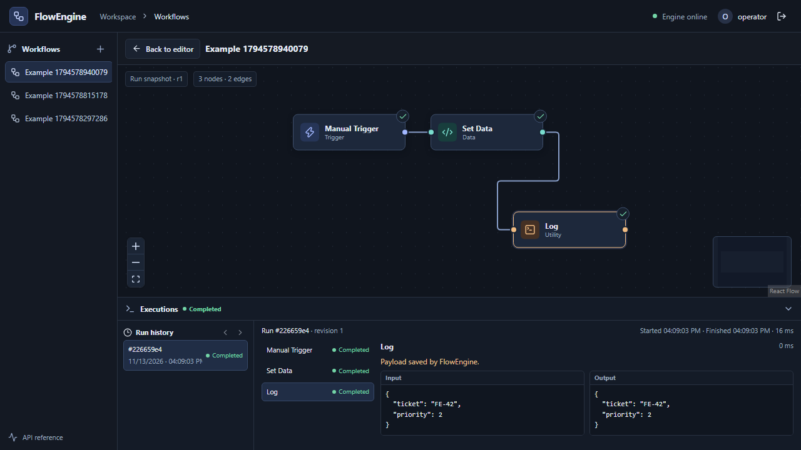

# FlowEngine

FlowEngine is an open-source visual workflow automation platform. Connect a **Manual Trigger**, **Set Data**, and **Log** node to run a JSON workflow and inspect each node’s input, output, and status.

The first release milestone covers saved drafts, manual execution through RabbitMQ, and persisted execution history. See the [roadmap](docs/roadmap.md) for publication, additional nodes, and hosted operation.

The backend runs on Java 25 and Spring Boot 4, with PostgreSQL for workflow and execution state. The editor uses React, TypeScript, and React Flow. Docker Compose runs the full stack locally.



## Run with Docker Desktop

Start Docker Desktop with Linux containers enabled. From the repository root in PowerShell:

```powershell
Copy-Item .env.example .env
code .env
docker compose up --build -d --wait
```

Set the three passwords in `.env` before running Compose. The operator password needs at least 12 characters and must fit within 72 UTF-8 bytes. Open [FlowEngine](http://127.0.0.1:5173) and sign in with the operator credentials in that file. The UI and infrastructure ports bind to loopback. Run `docker compose down` to stop the stack. Named volumes retain workflows and RabbitMQ data.

## Develop on Windows with PowerShell

Use a Java 25 JDK and Node.js 24 LTS. Check that `JAVA_HOME` points to the Java 25 installation even if `java -version` already resolves to it. Maven Wrapper downloads the pinned Maven release on first use. Use `npm.cmd` if PowerShell blocks the npm script shim.

1. Copy and fill in `.env` as above, then start just PostgreSQL and RabbitMQ.

   ```powershell
   docker compose up -d --wait postgres rabbitmq
   ```

   You can also use existing PostgreSQL and RabbitMQ services. Create a dedicated database and supply credentials with schema migration rights and permission to declare, publish to, and consume from the RabbitMQ queue.

2. Start the backend in one PowerShell terminal. Set the values to match your services and operator configuration.

   ```powershell
   $env:FLOW_DB_URL = 'jdbc:postgresql://127.0.0.1:55432/flowengine'
   $env:FLOW_DB_PASSWORD = '<database password>'
   $env:FLOW_RABBIT_PASSWORD = '<broker password>'
   $env:FLOW_OPERATOR_PASSWORD = '<operator password>'
   Set-Location backend
   .\mvnw.cmd spring-boot:run
   ```

   The Maven process reads environment variables from the terminal. Compose reads `.env` itself. See [configuration](#configuration) for optional overrides.

3. Start the UI in a second terminal from the repository root.

   ```powershell
   Set-Location frontend
   npm.cmd ci
   npm.cmd run dev
   ```

   Open [FlowEngine](http://127.0.0.1:5173). The Vite proxy provides a single browser origin for session cookies and API calls. Check [health](http://127.0.0.1:5173/actuator/health) or sign in to open [Swagger UI](http://127.0.0.1:5173/swagger-ui/index.html).

## Try a workflow

1. Create a workflow and drag **Manual Trigger**, **Set Data**, and **Log** onto the canvas. Clicking a node in the library also places it.
2. Select **Set Data** and enter `{"ticket":"FE-42","priority":2}` in **Values**. Set the Log message to `Payload recorded.`
3. Connect **Manual Trigger → Set Data → Log** by dragging from each right port to the next left port. The configuration panel also has a target picker for keyboard users.
4. Select **Save** or press **Ctrl+S**, then select **Run workflow**. Enter a JSON object such as `{"sku":"BIKE-123"}` and select **Run**. An empty field starts the workflow with `{}`.
5. In **Executions**, inspect the log and the output containing both the SKU and the fields added by **Set Data**. Return to the editor and run the same revision with another SKU. Each execution keeps its own input and output.

### Route a workflow by SKU

Connect **Manual Trigger** to **Condition**. Set **Field name** to `sku` and choose **Is empty**. Connect the `true` output to a **Set Data** node that assigns `{"busena":"reikia_perziuros"}` and the `false` output to a **Set Data** node that assigns `{"busena":"paruošta"}`. Save and run with `{"sku":""}` and then `{"sku":"BIKE-123"}`. The execution inspector shows the selected output and marks the unused branch **Skipped**.

### Select and rename fields

Add **Transform Data** after **Manual Trigger** or the ready branch above. Enter `{"productCode":"sku","priceEur":"price"}` in **Field mapping**. Run with `{"sku":"BIKE-123","price":1299,"busena":"paruošta"}` and inspect the node’s **Output** for `{"productCode":"BIKE-123","priceEur":1299}`. Mapping uses exact top-level keys, preserves JSON values including null, and omits missing keys.

### Start a workflow from HTTP

Use a **Webhook Trigger** in place of the Manual Trigger and save the workflow. Open **Webhook** in the toolbar, select **Enable webhook**, and copy the URL and bearer token. The token is shown when it is issued. For a local test, run this from PowerShell with the URL and token shown by your instance.

```powershell
$url = '<webhook URL>'
$token = '<bearer token>'
Invoke-RestMethod -Method Post -Uri $url `
  -Headers @{ Authorization = "Bearer $token" } `
  -ContentType 'application/json' `
  -Body '{"sku":"BIKE-123","price":1299}'
```

The endpoint returns HTTP `202` with an `executionId`. Open **Executions** to view the run. Enabling the webhook binds it to the saved revision. Saving a new revision requires enabling the webhook again and supplying the new token to the caller. The toolbar also offers token rotation and disabling.

### Send the result to an HTTPS API

Set `FLOW_HTTP_ALLOWED_HOSTS` to the exact hostnames that may receive workflow data. With Compose, set it in `.env` and run `docker compose up -d` to apply the configuration. For a local test with synthetic data, allow `httpbingo.org`.

Connect **Webhook Trigger → Transform Data → HTTP Request**. Set the mapping to `{"productCode":"sku","priceEur":"price"}`, then choose **POST** and enter `https://httpbingo.org/post` as the **URL**. Save the workflow, enable the webhook, and send the sample payload above. The HTTP node’s output in **Executions** includes the response `status` and `body`. The test API echoes the submitted fields under `body.json`. [HTTP testing endpoints](https://httpbingo.org/)

The node supports GET, POST, PUT, PATCH, and DELETE. POST, PUT, and PATCH send the node input as JSON. The URL is fixed in the saved workflow. Each call has a ten-second budget and a 64 KiB response body limit.

### Create a GitHub issue

Set `FLOW_GITHUB_REPOSITORY` to an issue-enabled repository in `owner/repository` format. Set `FLOW_GITHUB_TOKEN` to a fine-grained token scoped to that repository with **Issues: write**. With Compose, put these values in your local `.env` and run `docker compose up -d` to apply them. Keep the token in server configuration. [GitHub Create an issue API](https://docs.github.com/en/rest/issues/issues#create-an-issue)

To try the connector, create **Manual Trigger → GitHub · Create issue**. Set **Repository** to the configured repository, **Title field** to `title`, and **Description field** to `body`. Save and run it against a test repository with `{"title":"Check missing SKU","body":"Review product BIKE-123."}`. The node returns the issue number, URL, and repository. A **Webhook Trigger → Condition → GitHub · Create issue** workflow can use the same fields to open a review issue only when its condition matches.

## Verification

Run the backend suite with Docker Desktop active.

```powershell
Set-Location backend
.\mvnw.cmd verify
```

Run the frontend checks from `frontend`.

```powershell
npm.cmd ci
npm.cmd run lint
npm.cmd test
npm.cmd run build
```

Run the browser journey against a running development or Compose stack. Set `FLOW_OPERATOR_PASSWORD` to that stack’s password and `FLOW_OPERATOR_USERNAME` if you changed the username. The test creates a workflow in the target database, so use a development instance.

```powershell
npx.cmd playwright install chromium
npm.cmd run test:e2e
```

## Configuration

| Setting | Purpose | Local default |
| --- | --- | --- |
| `FLOW_DB_URL` | JDBC URL used by the host backend | `jdbc:postgresql://localhost:5432/flowengine` |
| `FLOW_DB_USER` / `FLOW_DB_PASSWORD` | Database role and password | `flowengine` / required |
| `FLOW_DB_PORT` | Host port for Compose PostgreSQL | `55432` |
| `FLOW_RABBIT_HOST` / `FLOW_RABBIT_PORT` | Broker address and host port | `localhost` / `5672` |
| `FLOW_RABBIT_USER` / `FLOW_RABBIT_PASSWORD` | Broker credentials | `flowengine` / required |
| `FLOW_RABBIT_MANAGEMENT_PORT` | Host port for the Compose broker console | `15672` |
| `FLOW_OPERATOR_USERNAME` / `FLOW_OPERATOR_PASSWORD` | Local operator account | `operator` / required |
| `FLOW_BIND_ADDRESS` / `FLOW_PORT` | Host Spring Boot listen address and port | `127.0.0.1` / `8080` |
| `FLOW_SECURE_COOKIE` | Require HTTPS for the session cookie | `false` for loopback HTTP |
| `FLOW_WEB_PORT` | Host UI port when using Compose | `5173` |
| `FLOW_HTTP_ALLOWED_HOSTS` | Comma-separated exact HTTPS destination hostnames | Empty |
| `FLOW_GITHUB_REPOSITORY` / `FLOW_GITHUB_TOKEN` | Repository and server-side Issues write token for the GitHub connector | Empty |
| `FLOW_DEV_API` | Vite’s backend proxy target | `http://127.0.0.1:8080` |
| `FLOW_E2E_URL` | Playwright target | `http://127.0.0.1:5173` |

See [architecture](docs/architecture.md) for graph rules, dispatch guarantees, and data handling.
