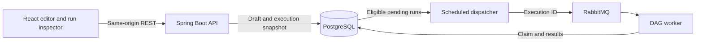

# Architecture

FlowEngine is a modular monolith. Spring Boot handles authentication, workflow management, dispatch, and consumption in a single application. PostgreSQL stores drafts and execution state. RabbitMQ transports execution IDs. React Flow edits and renders graphs. Zustand holds unsaved editor state, and TanStack Query fetches and polls the API.

## Graph and execution

A graph stores node IDs, types, labels, positions and configurations, and directed edges. The server supplies node definitions with port capabilities and field metadata. Each runnable workflow has exactly one Manual Trigger or Webhook Trigger. Every other node must have one parent and be reachable from the trigger. Fan-out is supported. Cycles and merges are rejected. A draft can contain disconnected components while it is being assembled. Draft writes use a revision precondition and JPA optimistic locking to protect concurrent edits.

Connections use an optional `sourcePort` that defaults to `out` for existing graphs. The Condition node checks an exact top-level JSON key. **Is empty** matches a missing key, JSON null, or a blank string. **Equals text** compares strings exactly. The original input flows through the selected `true` or `false` output. Nodes on the other branch and their descendants are marked skipped. If the selected output has no connection, that branch ends at the Condition node.

Transform Data builds a new object from an output-key-to-input-key mapping. Keys are exact, top-level strings. The node preserves the JSON value types, copies explicit null values, and omits mappings whose source key is absent.

HTTP Request uses the saved URL and method. POST, PUT, and PATCH serialize the input object as JSON. Successful calls return an object containing the status and a JSON, UTF-8 text, or null body. Non-2xx responses fail the node and record the status without persisting the error response body. The client skips redirects and automatic retries. A timed-out write may still have reached the destination.

The Manual Trigger passes the run’s input JSON object downstream. The run API accepts it in the optional `input` field and defaults to `{}` when omitted or null. Set Data shallow-merges JSON object keys into its parent’s output. A Log node preserves the input and records a literal message in execution history. A topological plan runs one node at a time. A failed node ends the run and marks the unvisited nodes skipped. The inspector reads the graph and input captured at enqueue time along with the node results, even after the draft is edited. Node records include timestamps, inputs, outputs, messages, and safe failure details. Status and history are fetched by polling.

## Delivery and recovery

1. The run request validates the saved revision and commits a `PENDING` row with a graph snapshot and the submitted input. That row is the durable dispatch intent.
2. The dispatcher reserves up to 32 eligible rows using PostgreSQL `FOR UPDATE SKIP LOCKED` and advances their dispatch timestamps by 10 seconds. It publishes only the execution ID to a durable RabbitMQ queue. A row still pending after the interval becomes eligible again. This covers an interrupted publish or a lost delivery. Duplicate messages can occur.
3. A conditional database update gives one worker the `RUNNING` claim. A redelivered message for an already claimed or terminal run has no effect. The worker stores all node results and transitions the run to `COMPLETED` or `FAILED` before acknowledging a successful delivery.
4. The deadline is 30 seconds from claim. The engine checks it around each node and the application periodically fails overdue claims. A worker crash after claim can leave a failed execution without node details. Claimed runs are never replayed automatically. User-initiated run requests each create a separate execution.

The delivery model permits repeated dispatch and guards against repeated claims for the same execution ID. Future external action nodes will need per-action timeouts and their own idempotency strategy.

## Security and storage

The first iteration uses one environment-provisioned operator with a BCrypt password hash and a Spring Security session. Browser writes use a CSRF token. The API checks ownership on workflows and on their associated execution history. API payloads are capped at 128 KiB, with up to 50 nodes per workflow. Swagger requires a session. The loopback configuration is intended for local development. Shared or hosted deployments will need account management, TLS and secure cookies, authentication rate limiting, and a backup and retention policy.

Workflow snapshots and results are stored in PostgreSQL JSONB. They can include user-supplied data, so use sample payloads and keep credentials out of node fields. Log messages stay in run history. Deleting a workflow deletes its executions through the database foreign key. Existing Docker volumes keep their initialized database and broker credentials across restarts.

Only the workflow owner can enable, rotate, or disable its webhook. Registration validates the current revision and issues a 256-bit random bearer token. PostgreSQL stores the token’s SHA-256 hash and the registered revision. `POST /api/webhooks/{id}` accepts a JSON object up to 128 KiB and enqueues an execution after validating the token and revision. The bearer token authenticates this POST independently of the session. Management calls still require a session and CSRF protection for writes. The authenticated delivery limit is 30 accepted requests per workflow per fixed one-minute window, enforced atomically in PostgreSQL. Invalid tokens and stale registrations return 404, and accepted calls return 202 with an execution ID. Use HTTPS to carry tokens outside loopback.

Outbound requests require HTTPS on port 443 and an exact match in `FLOW_HTTP_ALLOWED_HOSTS`. The worker validates every DNS answer against its address restrictions, connects to a checked IP, and retains the hostname for TLS verification. Requests use a bounded worker pool and a ten-second deadline capped by the remaining workflow deadline. Request bodies are limited to 128 KiB and uncompressed response bodies to 64 KiB. For hosted deployments, enforce outbound network policy alongside the application controls. [OWASP SSRF prevention](https://cheatsheetseries.owasp.org/cheatsheets/Server_Side_Request_Forgery_Prevention_Cheat_Sheet.html)

## Stack compatibility

Tests use Spring Boot’s managed JUnit Jupiter 6 because Spring Framework 7’s integration test extension requires Jupiter 6 or higher. [SpringExtension requirements](https://docs.spring.io/spring-framework/docs/current/javadoc-api/org/springframework/test/context/junit/jupiter/SpringExtension.html)

The backend uses Java 25, Spring Boot 4.1, and springdoc 3.2. [Spring Boot system requirements](https://docs.spring.io/spring-boot/system-requirements.html) · [springdoc compatibility matrix](https://springdoc.org/#what-is-the-compatibility-matrix-of-springdoc-openapi-with-spring-boot-)

The frontend targets Node 24 LTS with Vite 8 and React Flow 12. The npm lockfile captures the installed dependency set. TypeScript 6.0 satisfies the pinned TypeScript ESLint peer range. [Vite 8 requirements](https://vite.dev/blog/announcing-vite8) · [React Flow 12 release notes](https://reactflow.dev/whats-new/2026-09-24)
